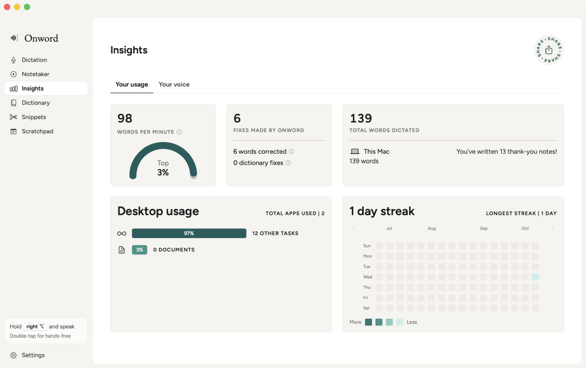
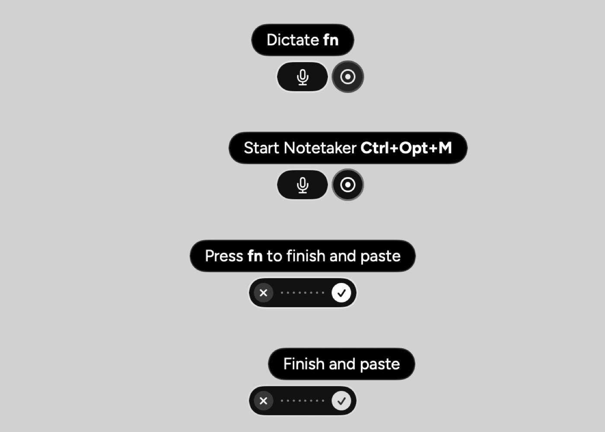
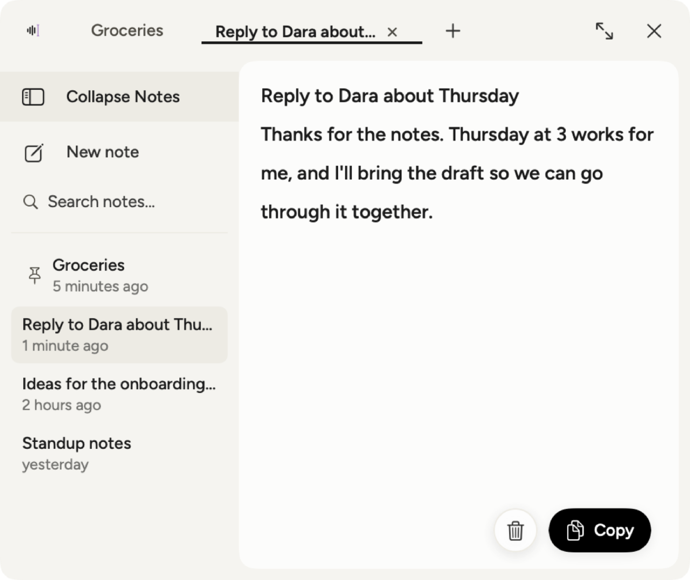
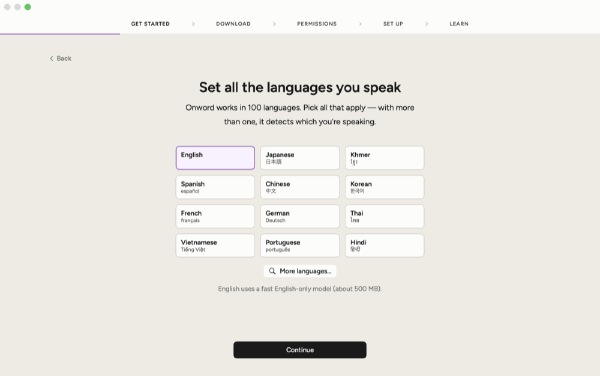
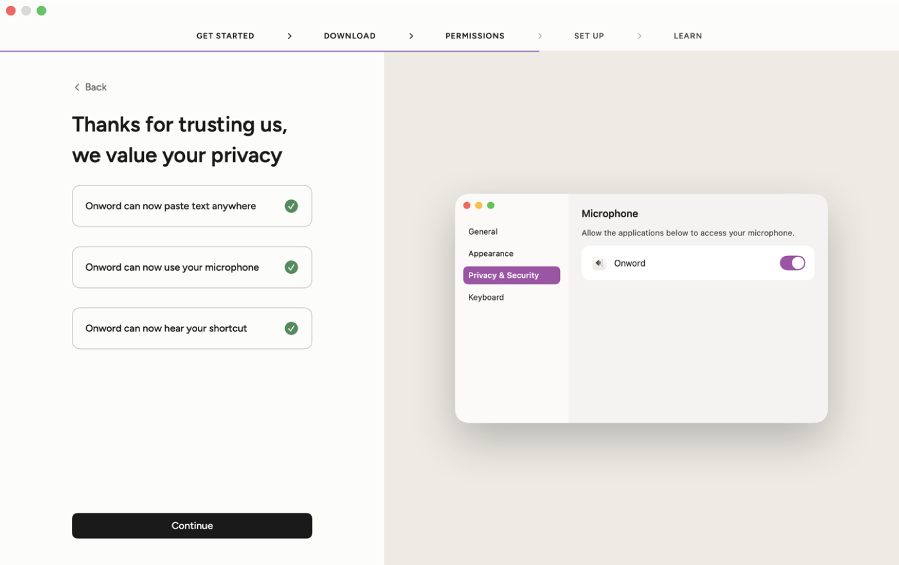

<div align="center">


# Onword

**Speak, and it's written.**<br>
Free, private voice-to-text for your Mac. Hold a key in any app, talk, let go — your words appear at the cursor.

[](https://github.com/h-thavy/onword/releases/latest)


[](LICENSE)



</div>

## Get started in 1 minute

**1. Install** — paste this into Terminal:

```bash
curl -fsSL https://raw.githubusercontent.com/h-thavy/onword/main/scripts/install.sh | bash
```

**2. Follow the setup** — it asks your name and languages, downloads the speech model (~500 MB, once), turns on three permissions, and lets you practice.

**3. Dictate** — click into any text field, **hold `fn`**, talk, and let go. That's it.

> Needs a Mac with **Apple Silicon** (M1 or later) on **macOS 14 Sonoma** or later. Run the same command again to update.

## Why Onword

- 🔒 **Private by design** — your voice never leaves your Mac. No account, no API key, no subscription.
- ⚡ **Works everywhere** — any app with a text field: Mail, Slack, Notion, your browser, your code editor.
- 🌍 **99 languages** — English, Khmer, Japanese, Chinese, Spanish and more. Pick several and Onword detects which one you're speaking.
- ✈️ **Offline** — after the one-time download, everything runs without internet.

## What's inside

| | |
|---|---|
| 🎙️ **Dictation** | Hold to talk, or double-tap for hands-free. Filler words ("um", "uh") disappear, *"scratch that"* deletes your last sentence, and *"new line"* breaks the line. Spacing and capitals match the text around your cursor. |
| 🟢 **Flow Bar** | A small bar above the Dock. Hover it to start dictating or take meeting notes with one click, see what's coming up in your calendar, and watch a live waveform while you talk. |
| 📝 **Notetaker** | Records calls **without a bot joining** — Zoom, Meet, Teams, FaceTime, Slack and more. Live transcript, who-said-what with real names, and a summary with action items written on your Mac by Apple Intelligence. |
| 🗒️ **Scratchpad** | A floating notepad that opens at your pointer, over any app. Type or dictate quick thoughts, with tabs and search. |
| 📊 **Insights** | Your words per minute (and how it compares to typing), words dictated, the apps you use most, and your day streak. |
| 📖 **Dictionary & Snippets** | Teach Onword names and jargon, fix words it mishears, and expand short phrases into longer text ("my email" → your address). |

<table>
<tr>
<td width="50%"><br><sub><b>Flow Bar</b> — dictate or start Notetaker from above the Dock</sub></td>
<td width="50%"><br><sub><b>Scratchpad</b> — a floating notepad on ⌃⌥S</sub></td>
</tr>
<tr>
<td width="50%"><br><sub><b>Setup</b> — pick the languages you speak</sub></td>
<td width="50%"><br><sub><b>Setup</b> — three permissions, guided</sub></td>
</tr>
</table>

## Shortcuts

| Shortcut | What it does |
|---|---|
| Hold **fn** (or Right ⌥) | Dictate while held, paste when you let go |
| Double-tap **fn** | Hands-free — press once more to finish |
| **Esc** | Cancel |
| **⌥M** | Start or stop Notetaker |
| **⌃⌥S** | Show or hide the Scratchpad |

You can change the dictation key in **Settings → General → Shortcuts**.

## Privacy

Speech-to-text runs on your Mac with [WhisperKit](https://github.com/argmaxinc/WhisperKit), speakers are told apart with SpeakerKit, and summaries are written by Apple's on-device model. The only download is the speech model, once. Dictations are kept as text only — never audio — and everything lives in `~/Library/Application Support/Onword/`. Choose how long history is kept in **Settings → Data and Privacy**.

<details>
<summary><b>Permissions Onword asks for</b></summary>

| Permission | Why |
|---|---|
| Microphone | To hear you |
| Accessibility | To type where your cursor is, and match the text around it |
| Input Monitoring | To notice your shortcut while other apps are in front |
| System Audio Recording | Only for Notetaker, to record the other side of a call |
| Calendars | Optional — to show upcoming meetings |

Releases are signed with Onword's own certificate, so permissions carry over from one update to the next. If a permission ever shows as on in System Settings but Onword still asks for it, click **Allow** in Onword's **Settings → System**: it clears the old entry and asks again.
</details>

<details>
<summary><b>Troubleshooting</b></summary>

- **The shortcut does nothing.** Make sure Input Monitoring and Accessibility are on for Onword, then quit and reopen it. Using **fn**? Set System Settings → Keyboard → "Press 🌐 key to" → **Do Nothing**.
- **Another dictation app is running.** It may be using the same key — pick a different shortcut in Settings.
- **AirPods miss the first word.** Bluetooth mics take a moment to switch on. Choose the Mac's microphone in Settings → General → Microphone (you can still listen on AirPods).
- **Text didn't appear.** Some apps block pasting. Use **Copy last transcript** from the menu-bar menu.
- **See what's happening:** `log stream --predicate 'subsystem == "io.github.h-thavy.onword"'`
</details>

<details>
<summary><b>Uninstall</b></summary>

```bash
# Remove the app, keep your history, notes and meetings
curl -fsSL https://raw.githubusercontent.com/h-thavy/onword/main/scripts/install.sh | bash -s -- --uninstall

# Remove everything, including your data and downloaded models
curl -fsSL https://raw.githubusercontent.com/h-thavy/onword/main/scripts/install.sh | bash -s -- --uninstall --purge
```
</details>

<details>
<summary><b>Build from source</b></summary>

Requires Xcode 16 or later.

```bash
git clone https://github.com/h-thavy/onword.git && cd onword
scripts/build-app.sh      # → build/Onword.app
open build/Onword.app
swift test                # unit tests for the core logic
```

- `Sources/OnwordCore` — pure logic with unit tests (text clean-up, shortcut gestures, transcripts, insights)
- `Sources/Onword` — the app (audio, transcription, text insertion, meetings, UI)
- `scripts/` — build, release, install and icon scripts

`ONWORD_TEST_AUDIO=/path.wav` uses a WAV file instead of the microphone, and `kill -USR1 $(pgrep -x Onword)` saves window snapshots to `/tmp/onword-snapshots`.
</details>

## Credits

Built with [WhisperKit and SpeakerKit](https://github.com/argmaxinc/WhisperKit) by Argmax (MIT), and the [EB Garamond](https://fonts.google.com/specimen/EB+Garamond) and [Figtree](https://fonts.google.com/specimen/Figtree) fonts (SIL Open Font License). Inspired by voice-dictation apps such as Wispr Flow — Onword is an independent project, not affiliated with or endorsed by Wispr.

[MIT License](LICENSE)
