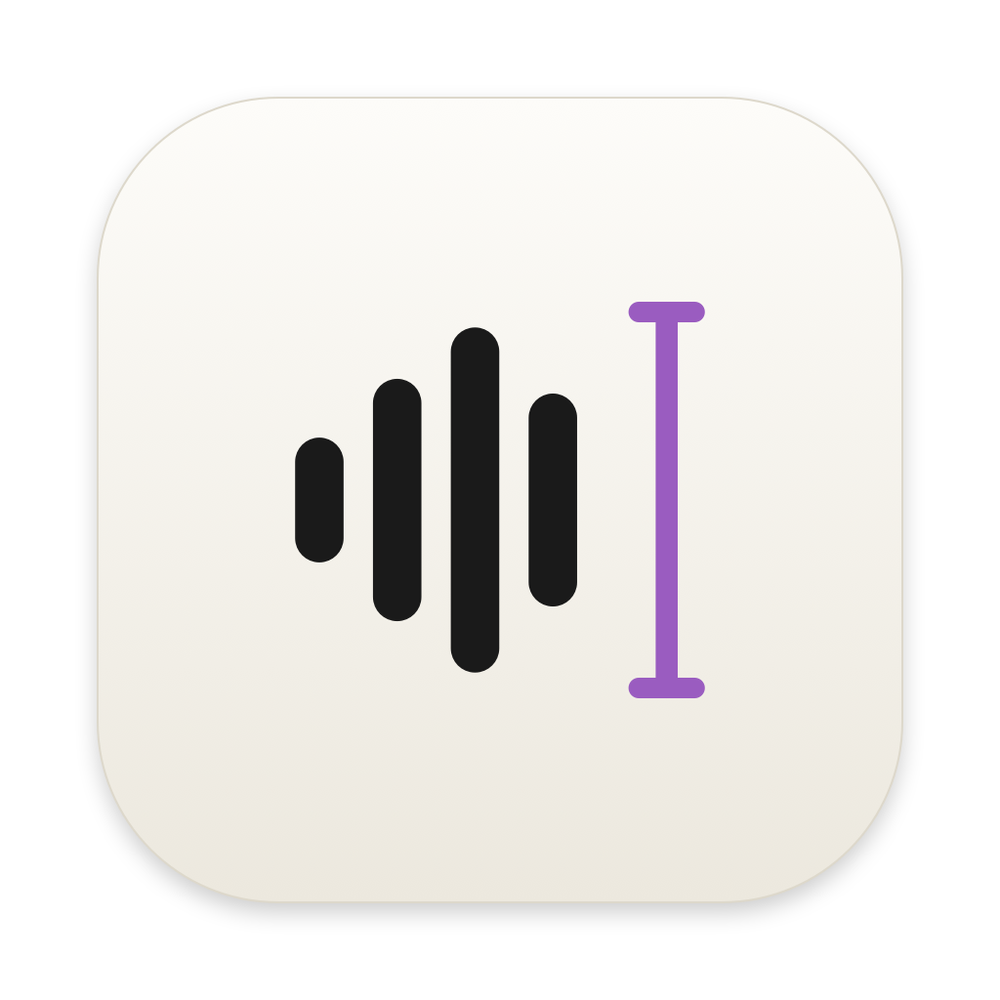

# Onword

**Speak, and it's written.** Onword is a free, private voice-to-text app for macOS. Hold a key in any app, speak, let go, and your words are typed where your cursor is. It also takes notes in your meetings.

Everything runs **on your Mac**: no account, no API key, no subscription. Nothing you say is sent anywhere.

## Install

```bash
curl -fsSL https://raw.githubusercontent.com/h-thavy/onword/main/scripts/install.sh | bash
```

This downloads the latest release, checks its checksum, installs **Onword.app** in `/Applications` (or `~/Applications` if `/Applications` isn't writable), and opens it. A short setup then downloads the speech models, walks you through permissions, tests your shortcut on an on-screen keyboard, and lets you practice hold-to-talk and hands-free dictation.

Run the same command again to **update**. To **uninstall**:
```bash
curl -fsSL https://raw.githubusercontent.com/h-thavy/onword/main/scripts/install.sh | bash -s -- --uninstall
```
Add `--purge` to also delete your history, notes, meetings and downloaded models.

**Requirements:**
- A Mac with **Apple Silicon** (M1 or later) running **macOS 14 Sonoma** or later.
- An internet connection the first time, and about **1 GB** free: setup downloads the speech model (about 500 MB) and the speaker model (11 MB) once, and won't continue until they're on your Mac. After that Onword works **fully offline**. If a download fails, it retries on its own (and as soon as you're back online), and a damaged download is fetched again automatically.
- Meeting summaries also need **macOS 26 with Apple Intelligence** turned on.

## What it does

### Dictation
| Do this | Result |
|---|---|
| Hold your shortcut (Right ⌥ by default), speak, release | Text appears at your cursor, in any app |
| Double-tap the shortcut | Hands-free: keeps listening until you press it again |
| Esc | Cancel |
| Say "new line" / "new paragraph" | Line break / blank line |
| Say "… scratch that …" | Deletes the sentence you just said |
| "um", "uh" | Removed automatically (can be turned off) |

Onword matches the text around your cursor, adding a space or a capital letter when needed. It inserts text directly into native text fields and falls back to a clipboard paste elsewhere; your clipboard is restored afterwards. If you switch apps before the text is ready, it's put on your clipboard instead of typed into the wrong place.

**Languages:** English by default, or any of Whisper's 99 languages (Japanese, Chinese, Khmer, Thai, Spanish…) under Settings → General → Languages. Pick several and Onword detects which one you're speaking. Languages other than English need a one-time download of the multilingual model (about 500 MB); you can keep dictating meanwhile.

### Flow Bar
A small bar sits above the Dock (or near the bottom of the screen when the Dock is hidden). Hover it to start a hands-free dictation or Notetaker with one click; while you dictate it shows a live waveform, and hands-free shows ✕ / ✓ to cancel or finish. Right-click for Hide for 1 hour, microphone and more. Turn it off in Settings → System.

### Insights
Words per minute (and how that compares with typing speeds), fixes Onword made, total words, which kinds of apps you dictate into, and a day-streak heatmap — all worked out on your Mac from your history. The *Your voice* tab adds your most used and most corrected words and your peak dictation time.

### Notetaker (⌥M)
Records calls **without a bot joining**: your microphone and your Mac's audio output are recorded as two separate tracks.
- **Call detection:** Onword can notice a call (Zoom, Teams, FaceTime, Webex, Discord, or Google Meet / Teams / Slack huddles in a browser) and ask whether to record. It stops when the call ends.
- **Live transcript** while you talk.
- **Who said what:** you are **Me**, and the other side is split into speakers on-device. With Meet, Teams, Slack or Zoom, speakers get **real names** from the call app's "active speaker" highlight. Rename a speaker by clicking them; give two speakers the same name to merge them.
- **Summary, decisions and action items**, written on-device by Apple Intelligence (macOS 26). An action item is kept only if the transcript supports it.
- **Export:** Copy as Markdown, or export a `.md` file.
- **Calendar:** the Notetaker lists your upcoming meetings with a **Join & Record** button, reminds you when one starts, and names the recording and speakers after the event and its guests. To include **Google Calendar**, add your Google account in System Settings → Internet Accounts (with Calendars on), then click **Use Mac Calendar** in Notetaker or Settings → Connections. iCloud, Outlook and Exchange calendars work the same way.

### Scratchpad (⌃⌥S)
Quick notes you can type or dictate into, with search and pinning. ⌃⌥S opens a floating window at your mouse pointer, over any app and in full screen; press it again to hide the window (your notes stay open). Up to five notes open as tabs (⌘T new, ⌘W close, double-click to rename), and ⌘E shows the notes list. Notes save on their own. The Scratchpad page in Onword lists all notes; click one to open it in the window.

### Microphone
By default Onword uses **Automatic**: your AirPods or another Bluetooth/USB headset when one is connected, otherwise the Mac's microphone, and it switches mid-recording when you connect or disconnect one. You can pick a fixed microphone in Settings → General.

### Dictionary & Snippets
- **Dictionary:** names and jargon to spell your way, plus corrections for words Onword keeps mishearing ("flow light" → "Onword").
- **Snippets:** say a trigger phrase, get longer text ("my email" → your address).

## Privacy
- Speech-to-text runs locally with [WhisperKit](https://github.com/argmaxinc/WhisperKit) (Whisper on Core ML); speaker identification with SpeakerKit; summaries with Apple's on-device model.
- The only network use is downloading the speech and speaker models from Hugging Face, once.
- **Dictations** are kept as text only, never audio.
- **Meetings** keep their audio on your Mac so they can be re-processed. Deleting a meeting deletes its audio.
- Everything lives in `~/Library/Application Support/Onword/`.

## Permissions
The setup asks for these; you can review them later in **Settings → System**.

| Permission | Why |
|---|---|
| Microphone | To hear you |
| Accessibility | To put text where your cursor is and read the text around it (used only on this Mac) |
| Input Monitoring | To notice your shortcut while other apps are in front |
| System Audio Recording | Only when you use Notetaker, to record the other side of the call |
| Calendars | Optional, only if you connect your calendar |

Release builds aren't signed with an Apple Developer ID. Because of that, macOS may ask you to grant Accessibility and Input Monitoring again **after updating**: in System Settings → Privacy & Security, remove Onword with **–** and add it again.

## Troubleshooting
- **The shortcut does nothing.** Check that Input Monitoring and Accessibility are on for Onword, then quit and reopen it. If you picked **Fn**, set System Settings → Keyboard → "Press 🌐 key to" → **Do Nothing**.
- **Another dictation app is running.** Apps that intercept keys can swallow Onword's shortcuts; use a different shortcut in Settings.
- **AirPods miss the first word.** Bluetooth mics switch to call-quality audio when recording starts. Choose the built-in microphone in Settings → General → Microphone (you can keep listening on AirPods).
- **Text didn't appear.** Some apps block simulated paste. Use **Copy last transcript** in the menu-bar menu.
- **Logs:**
  ```bash
  log stream --predicate 'subsystem == "io.github.h-thavy.onword"'
  ```

## Build from source
Requires Xcode 16 or later.
```bash
git clone https://github.com/h-thavy/onword.git && cd onword
scripts/build-app.sh            # → build/Onword.app
open build/Onword.app
swift test                      # unit tests for the core logic
```
- **Signing:** `build-app.sh` signs with your first Apple Development or Developer ID identity, so permissions survive rebuilds. `SIGN_IDENTITY=-` gives an ad-hoc build.
- **Releasing:** `scripts/release.sh` builds a release zip and checksum, and `scripts/make-icon.swift` regenerates the icon.

**Testing without speaking:**
- `ONWORD_TEST_AUDIO=/path.wav` uses a WAV file instead of the microphone.
- `ONWORD_TEST_MEETING=/folder` imports `mic.wav` / `system.wav` from that folder as a meeting.
- `kill -USR1 $(pgrep -x Onword)` saves window snapshots to `/tmp/onword-snapshots`.

| Folder | Contents |
|---|---|
| `Sources/OnwordCore` | Pure logic with unit tests: text cleanup, shortcut gestures, transcript merging, speaker naming, meeting rules |
| `Sources/Onword` | The app: audio capture, transcription, text insertion, detection, meetings, UI |
| `Resources` | Info.plist, entitlements, icon, fonts |
| `scripts` | Build, release, install and icon scripts |

## Credits
- [WhisperKit and SpeakerKit](https://github.com/argmaxinc/WhisperKit) by Argmax (MIT).
- [EB Garamond](https://fonts.google.com/specimen/EB+Garamond) and [Figtree](https://fonts.google.com/specimen/Figtree) fonts (SIL Open Font License, included in `Resources/Fonts`).
- Inspired by voice-dictation apps such as Wispr Flow. Onword is an independent project and is not affiliated with or endorsed by Wispr.

## License
[MIT](LICENSE)
